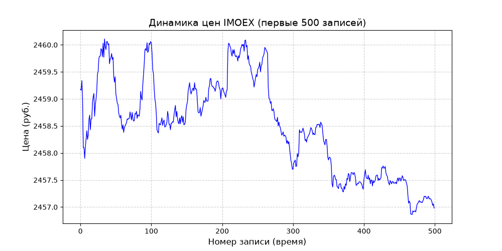
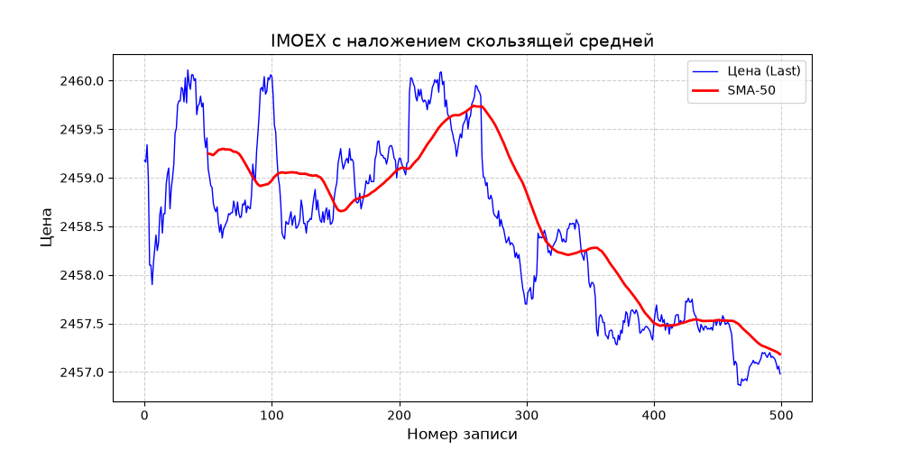
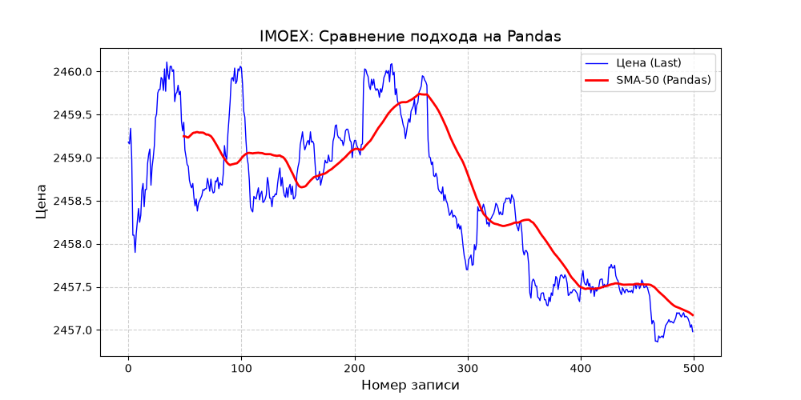

Название проекта: Анализ биржевых данных IMOEX на Python.

Цель: Сравнение базового модуля csv и библиотеки Pandas для расчета индикатора SMA-50.

Что внутри: impex.py — ручной парсинг и вывод графика, imoex_pandas.py - с помощью Pandas и imoex_pandas_plot.py — вывод графика.

Результат: 

